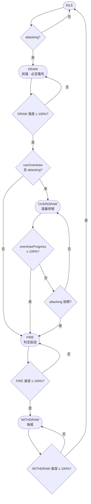

# 攻擊狀態機

`AttackHandler` 的四階段模型。命名來自弓（Draw / Overdraw / Fire / Withdraw），
但**設計上是通用的攻擊進程**，不限遠程武器。

---

## 四個狀態

一次攻擊 = **前搖 → 攻擊動作 → 後搖**，中間可選一段**滿蓄停頓**。

| 狀態 | 意義 | 揮刀 | 拉弓 |
|---|---|---|---|
| `DRAW` | **前搖**：把武器從預設位置移到「攻擊起始位置」 | 刀從腰間舉到過頭 | 拉弓的過程 |
| `OVERDRAW` | **滿蓄停頓**：維持在攻擊起始位置不放 | 高舉過頭停住蓄勢 | 弓拉到底 hold 住 |
| `FIRE` | **攻擊動作本身**，判定發生在這裡 | 從過頭揮到底 | 放弦 |
| `WITHDRAW` | **後搖**：從攻擊結束位置回到預設位置 | 刀從底部收回腰間 | 射完的復位動畫 |

### `FIRE` 是一個區段，不是一個瞬間

`FIRE` 涵蓋整個攻擊動作，可以是瞬間也可以是一段動畫。兩種 payload 型態：

- **投射物**：在 `FIRE` 的**第一幀**生成一次，之後的幀只是推進動畫
- **近戰揮擊**：整個 `FIRE` 區段都是判定窗，適合多段命中

### `DRAW` 與 `FIRE` 的分界

分界點是「攻擊起始位置」——武器就位、但攻擊還沒發生的那一刻。
`DRAW` 是就位的過程，`FIRE` 是從就位開始真正打出去。

### `DRAW` 一定會播完

`DRAW` 是前搖，**不能中途取消，一定推進到 100%**。

這不只是手感決定，也是數值一致性的要求：`attackFrequency` 定義為
`DRAW + FIRE + WITHDRAW` 三段總長的倒數。如果 `DRAW` 的長度可以隨玩家放手而改變，
`attackFrequency` 就失去意義了。**兩者不能並存。**

> 早期草案曾有一個 `chargeable` 開關，允許在 `DRAW` 未滿時放開即發射，
> 蓄力程度取當下的 `DRAW` 進度。**該設計已廢棄**，理由如上。
> 蓄力一律發生在 `OVERDRAW`。

---

## 一個開關：`canOverdraw`

只影響 `DRAW` 達 100% 的那一刻：

| `canOverdraw` | `DRAW` 滿時的行為 |
|---|---|
| `true` | 若 `attacking` 仍按著 → `OVERDRAW`；否則 → `FIRE` |
| `false` | 一律 → `FIRE`，永遠不會進 `OVERDRAW` |

由 `AttackBehaviour`（type）提供，不是 `Skill` 上的獨立欄位。

### 長按連發是這個開關的自然結果

先區分兩種「連發」，它們差在**射速由誰決定**：

| 型式 | 需要什麼 | 射速取決於 |
|---|---|---|
| **連點型** | 任何型態都行 | 玩家手速 + 循環時間 |
| **長按型** | `canOverdraw = false` | **恰好 `1 / attackFrequency`**，資料寫死 |

連點型不是機制，是「重複攻擊」的自然結果，任何攻擊都做得到。
真正需要開關支援的是長按型。

`canOverdraw = false` 時，按著 `attacking` 不放會形成循環：

```text
DRAW → FIRE → WITHDRAW → IDLE →（attacking 仍為 true）→ DRAW → ...
```

因為永遠進不了 `OVERDRAW`，所以不會停下來等玩家放手，
而這個循環的週期**正好就是 `1 / attackFrequency`**——射速與攻速數值天然一致，
不需要額外的冷卻機制。

### 兩個旋鈕組合出三種長按行為

`canOverdraw` 與 `OverdrawProgress` 是**真正正交**的，不是只有開關兩種局面：

| `canOverdraw` | `OverdrawProgress` | 按著不放會怎樣 | 循環週期 |
|---|---|---|---|
| `false` | — | 一直繞 `DRAW → FIRE → WITHDRAW → IDLE` | `1 / attackFrequency` |
| `true` | 恆為 `0`（預設） | 停在 `OVERDRAW` 蓄力，**不會重複** | 無 |
| `true` | 會達到 `1` | 蓄滿自動發射，然後繼續下一輪 | `1 / attackFrequency` + 蓄滿時間 |

> **中間那列是個容易誤踩的陷阱**：`canOverdraw = true` 而型態又沒有提供
> 「放手以外」的離開條件時，玩家按著就永遠卡在 `OVERDRAW`，循環回不到 `IDLE`。
> 這是刻意的（弓就該這樣），但設計新型態時要意識到自己選的是哪一種。

---

## 狀態轉換

圓角框為狀態，菱形為判斷。



---

## 進度模型

### `DRAW` / `FIRE` / `WITHDRAW`：一個頻率 + 三個權重

`attackFrequency` 是**每秒可完成幾次完整攻擊循環**，三段用**權重**分這個循環：

```text
循環總長   = 1 / attackFrequency
某段時長   = 循環總長 × (該段權重 / 權重總和)
```

也就是 `1 / (DRAW + FIRE + WITHDRAW) = attackFrequency`。

| 欄位 | 預設 | 意義 |
|---|---|---|
| `attackFrequency` | `1` | 每秒幾次完整循環 |
| `drawWeight` | `1` | 前搖佔幾份 |
| `fireWeight` | `0` | 判定佔幾份，**`0` = 瞬發** |
| `withdrawWeight` | `1` | 後搖佔幾份 |

**為什麼用權重而不是絕對秒數**：攻速加成（haste、武器詞綴）只要乘 `attackFrequency`，
三段自動等比縮放。權重描述「攻擊的**形狀**」，頻率描述「攻擊的**快慢**」，兩者正交。

**與現有行為的對應**：現有程式碼是 `drawPercentage = time * attackFrequency * 2f`，
滿 100% 的條件是 `time >= 1 / (2 × attackFrequency)`。代入權重 `1 : 0 : 1`：
`DRAW 時長 = (1/f) × 1/2 = 1/(2f)` — **完全相同**。所以 `1, 0, 1` 精確重現目前時序。

**邊界情況**

- 權重總和為 `0` → 三段都視為瞬發（避免除以零）
- 單一權重為 `0` → 該段時長 `0`，進度直接視為 `1`，單幀通過
- `attackFrequency <= 0` → 視為無效，套用最小值

### `OVERDRAW`：兩個各自獨立的百分比

`OVERDRAW` 不屬於連發循環，也沒有天然的結束時機，所以它需要**兩個不同的百分比**——
這是它與其他三個狀態唯一的結構差異。

| | 名稱 | 來源 | 用途 | 可否超過 100% |
|---|---|---|---|---|
| **強度** | `chargeRatio` | `time / fullChargeTime`（共用邏輯，純資料） | 廣播給動畫、日後餵傷害計算 | 可以（過蓄） |
| **完成度** | `overdrawProgress` | **由 `AttackBehaviour` 提供** | `≥ 100%` 就結束滿蓄、進 `FIRE` | — |

**為什麼要分開**：`chargeRatio` 是可預測的共用數值，動畫與傷害都要用它；
但「什麼時候該結束滿蓄」是各種攻擊各自的規則，不該由同一個數值兼任。

> **`fullChargeTime` 不是 `OVERDRAW` 的狀態時長。**
> 它只是強度量表的斜率——「幾秒可以蓄滿」。`OVERDRAW` 實際停留多久，
> 由玩家放手或 `overdrawProgress` 決定，可以比 `fullChargeTime` 更久（過蓄）或更短。
> 這也是它不該叫 `overdrawPeriod` 的原因：專案裡 `period`（如 `dodgePeriod`）
> 指的是狀態時長，語意會撞在一起。

`AttackEvent` 廣播的是**強度**（維持現有行為，動畫會隨蓄力推進）。

完成度的三種常見寫法：

- **無限 hold**（目前的弓）：恆為 `0`，永遠等玩家放手 ← 預設值
- **耐力型**：`1 - 耐力 / 上限`，耐力見底自動發射
- **過蓄上限**：`已 hold 時間 / 上限`

### 蓄力程度 = 離開 `OVERDRAW` 時的強度

既然 `DRAW` 不能中途放，唯一的蓄力就是在 `OVERDRAW` 停留的時間。
`AttackContext.ChargeRatio` 取離開 `OVERDRAW` 當下的強度值；
沒進過 `OVERDRAW` 就是 `0`。

---

## 職責分界：狀態機 vs `Skill`

**這是整個設計最重要的一條線。**

| | 負責什麼 | 不負責什麼 |
|---|---|---|
| `AttackHandler`<br>（狀態機） | 推進進度、依 `canOverdraw` 決定轉換、廣播 `AttackEvent` | 任何「這個技能會發生什麼事」的規則 |
| `AttackBehaviour`<br>（type） | `canOverdraw`、`OVERDRAW` 完成度、`FIRE` 時做什麼 | 狀態怎麼轉換、共用的進度怎麼算 |
| `Skill`<br>（ScriptableObject） | **純資料**：type、頻率、權重、prefab、offset | 行為 |

狀態機是**骨架**，`AttackBehaviour` 是**內容**，`Skill` 是**參數**。

> type 若要提前結束 `OVERDRAW`，**應該直接要求切換 state，而不是去動共用的強度值**。
> 強度是外部共用邏輯算出來的，動它會連帶影響動畫與傷害。

### 建議形狀：`Skill` 純資料 + type 對應的行為策略

```csharp
// ── 純資料，設計師在 Inspector 調 ──────────────────
public class Skill : ScriptableObject
{
    public AttackType type;              // 決定套哪一套行為

    public float attackFrequency = 1f;   // 每秒幾次完整循環
    public float drawWeight      = 1f;   // 三段權重，分掉 1/attackFrequency
    public float fireWeight      = 0f;   // 0 = 瞬發
    public float withdrawWeight  = 1f;
    public float fullChargeTime  = 1f;   // 強度蓄滿所需秒數（不是 OVERDRAW 的時長）

    public Projectile projectilePrefab;
    public Vector3 offset, direction;
}

// ── 行為策略，在程式碼裡 ──────────────────────────
public abstract class AttackBehaviour
{
    public abstract bool CanOverdraw { get; }

    // 圖上的 QD：OVERDRAW 的「完成度」，>= 1 就結束滿蓄進 FIRE。
    // 預設恆為 0 = 無限 hold，等玩家放手（目前弓的行為）。
    // 注意這與廣播出去的「強度」是兩回事，強度由共用邏輯算。
    public virtual float OverdrawProgress(in AttackContext ctx, float elapsed) => 0f;

    public virtual void OnEnterFire(in AttackContext ctx) { }
    public virtual void OnFireTick(in AttackContext ctx, float progress) { }
}

// 目前 AttackHandler 裡寫死的那套邏輯，就是這一個 type
public sealed class RangeChargeAttackBehaviour : AttackBehaviour
{
    public override bool CanOverdraw => true;
    // OverdrawProgress 不覆寫 → 無限 hold，等玩家放手

    public override void OnEnterFire(in AttackContext ctx)
        => ctx.Spawner.Spawn(ctx.Skill.projectilePrefab, ctx.Sender, ctx.ChargeRatio);
}

// 依賴用參數傳進來，行為不自己去找全域狀態
public readonly struct AttackContext
{
    public readonly Transform Sender;
    public readonly Skill Skill;
    public readonly float ChargeRatio;   // 離開 OVERDRAW 時的強度
    public readonly IProjectileSpawner Spawner;
}
```

`AttackHandler` 用 `type → AttackBehaviour` 查表分派（策略無狀態，一個 type 一個實例即可），
**內部不應該出現任何 `switch (type)`**。新增攻擊型態 = 新增一個 `AttackBehaviour` 子類別。

真的出現大量重複時再抽共用基底，屆時會有具體證據知道該抽什麼——
不需要預先把所有組合列出來。

#### 為什麼不用「`Skill` 繼承 + virtual method」

把行為直接掛在 SO 上是另一種常見寫法，但在 Unity 有實際痛點：

- asset 建立後**無法更換 script type**，改變主意就得重建 asset 並重接所有引用
- 同一種行為的十個技能 = 十個 asset，差異卻只是數值
- 策略邏輯散在 asset 裡，難以單元測試

用 `type` + 程式碼裡的策略類別，資料與行為各自待在最適合的地方。

---

## `attacking` 這個旗標的職責

`attacking` 是 `attackInput` 的鏡像，代表「攻擊鍵目前是否按著」。
它承擔**三個語意不同的角色**：

| 位置 | 判斷 | 語意 |
|---|---|---|
| `IDLE` | `if (attacking)` | **起手訊號**：開始一次攻擊（連發時也是靠這個續行） |
| `DRAW` 滿 | `canOverdraw && attacking` | **續持意向**：要不要停在滿蓄 |
| `OVERDRAW` | `if (!attacking)` | **釋放訊號**：放手打出去 |

同一個 bool 在不同狀態下意思完全不同。目前可行，但這是之後加入「連段」「取消」
等機制時第一個會撐不住的地方。

### 與 `canAttack` 的區別（不要混淆）

- **`attacking`** — 玩家的輸入意圖，由 `AttackController` 推入
- **`canAttack`** — 外部權限，由 `CharacterStateHandler` 廣播（翻滾中為 `false`）

`canAttack` 為 `false` 時是**從外部強制打斷**：`OVERDRAW` 直接跳 `FIRE`，
其他非 `FIRE` 狀態直接歸 `IDLE`。這是目前唯一的取消機制，而且相當粗暴——
它不是狀態機自己的概念，而是被外力硬掰。

---

## TODO

**已完成**（`7ae2fb0`）

- [x] 抽出 `AttackBehaviour` 多型，新增 `RangeChargeAttackBehaviour`（= 原本寫死的邏輯）
- [x] `Skill` 加 `type`，週期改成 `attackFrequency` + 三個權重（`1 : 0 : 1` 還原現狀）
- [x] `AttackHandler` 改用多型分派，`CanOverdraw` 取自行為，內部無 `switch (type)`
- [x] `OVERDRAW` 分出「強度」`chargeRatio` 與「完成度」`overdrawProgress`
- [x] 改名：`Skill.overdrawPeriod` → `fullChargeTime`（asset 自動取到預設值 `1`，無需重設）
- [x] `AttackEvent.percentage` 拆成 `progress` + `chargeRatio`，`AnimationHandler` 跟著改
- [x] 移除 `Skill.Fire()`——生成屬於行為，不屬於資料

**等 `IProjectileSpawner` 就位後（計畫 Phase 16）**

- [ ] `AttackContext.Spawner` 接上真正的投射物生成
- [ ] `FIRE` 區段化（`fireWeight > 0`），並決定 `FIRE` 播什麼動畫
      — 目前 `PlayerController.controller` 裡沒有 Fire state，`AnimationHandler` 是播 `"Withdraw"`

**更後面**

- [ ] `WITHDRAW` 的取消窗（cancel window）→ 連段、翻滾取消後搖
- [ ] 位移攻擊與 `MovementHandler` 的協調
- [ ] 通道型攻擊「期間可主動中止」的規則
- [ ] 過蓄（強度 > 100%）的懲罰或獎勵規則
- [ ] 狀態命名改為通用術語（見文末）

---

## 目前實作與設計的落差

上面描述的骨架**已經實作完成**（`7ae2fb0`）：多型分派、權重制、
`OVERDRAW` 的兩個百分比、`Skill` 純資料 + `type`，都已就位。
以下是尚未收斂的部分。

### 1. `FIRE` 仍是瞬發

`fireWeight` 預設 `0`，所以 `FIRE` 一幀就過。這與重構前等價，
但要做「攻擊動作」區段或多段命中時得把權重調起來，並決定 `FIRE` 播什麼動畫
（目前 `PlayerController.controller` 沒有 Fire state，`AnimationHandler` 播 `"Withdraw"`）。

### 2. `IProjectileSpawner` 尚無實作

介面已宣告，`AttackContext.Spawner` 目前傳入 `null`，
`RangeChargeAttackBehaviour.OnEnterFire` 會安靜跳過。
狀態機正常運轉，只是不會有投射物飛出來。等物件池重整（計畫 Phase 15、16）。

### 3. 只有一種 `AttackType`

`RangeCharge` 是目前唯一的型態。近戰揮擊、連發（`CanOverdraw => false`）
等要等實際需要時再新增子類別。

### 4. 時序由數值驅動，不是由動畫驅動

`AnimationHandler` 收到百分比後做 `animator.Play(state, layer, percentage)`，
用 normalizedTime 強制把動畫對齊到狀態機進度。

**這是刻意的取捨：動畫是狀態機的從屬，不是相反。**

- 優點：時序完全由 `Skill` 資料控制；換動畫不影響邏輯；同一套邏輯套不同武器
- 代價：動畫本身的節奏被壓平拉伸；無法用 animation event 決定判定時機

---

## 命名

### 統一原則

**每個狀態都有一個 `progress`（0→1，滿了就換狀態）。
`OVERDRAW` 額外有一個 `chargeRatio`（強度，可超過 1，不控制轉換）。**

只要照這條線走，看到名字就知道它會不會影響狀態轉換。

### 已改的名字（`7ae2fb0`）

| 原本 | 改成 | 理由 |
|---|---|---|
| `Skill.overdrawPeriod` | `fullChargeTime` | 它是強度量表的斜率，不是狀態時長。專案裡 `period`（如 `dodgePeriod`）指狀態時長，語意會撞 |
| 區域變數 `drawPercentage`<br>（`OVERDRAW` 分支內） | `chargeRatio` | 跟 `DRAW` 毫無關係；`ratio` 表示 0→1 正規化且允許超過 1 |
| — | `overdrawProgress` | 新增。由 `AttackBehaviour` 提供的完成度 |

`chargeRatio` 與 `AttackContext.ChargeRatio` 同名，同一個概念從頭到尾同一個字。

> 未採用 `chargeMaxPeriod`：`Max` 與 `Period` 疊在一起容易被讀成
> 「最多能 hold 多久」，那是 `overdrawProgress` 管的事，不是這個欄位。

### `AttackEvent` 也拆開了

原本單一的 `percentage` 欄位**在不同狀態代表不同東西**——`DRAW`/`FIRE`/`WITHDRAW`
是進度，`OVERDRAW` 是強度。已改成兩個欄位：

```csharp
public class AttackEvent
{
    public AttackState attackState;
    public float progress;      // 該狀態的 0→1 進度
    public float chargeRatio;   // 強度，只在 OVERDRAW 之後有意義
}
```

`AnimationHandler` 各取所需：`OVERDRAW` 用 `chargeRatio` 驅動動畫
（維持現有視覺行為），其餘狀態用 `progress`。之後要做蓄力條 UI 時，
也能直接綁 `chargeRatio` 而不必猜。

### 狀態名稱（尚未執行）

若確定這是通用攻擊模型，弓術詞彙會讓後來的人誤以為只適用遠程。
格鬥遊戲的標準術語對應得更準：

| 現在 | 建議 | 意義 |
|---|---|---|
| `DRAW` | `WINDUP` | 前搖 |
| `OVERDRAW` | `CHARGED` | 滿蓄停頓 |
| `FIRE` | `ACTIVE` | 判定區段 |
| `WITHDRAW` | `RECOVERY` | 後搖 |
